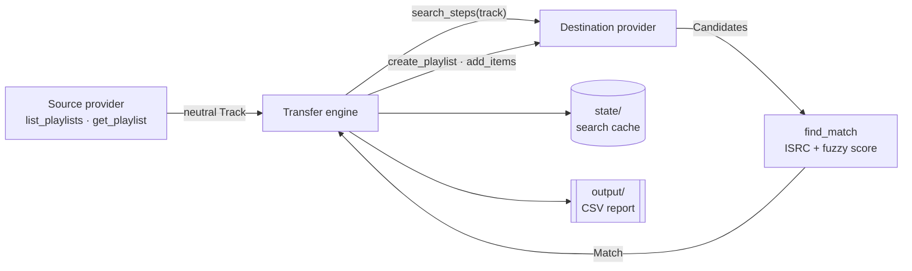

# music-transfer

Move playlists between **Spotify, YouTube Music, Deezer, Apple Music and SoundCloud**, in any direction, from the command line.

Each track is looked up on the destination with an exact ISRC lookup where the service supports one, and fuzzy title/artist matching otherwise. Duration and album checks catch wrong versions. Runs can be resumed, nothing gets added twice, and every transfer writes a CSV report with what matched, what was uncertain and what wasn't found.

```
$ music-transfer transfer --from spotify --to ytmusic --playlist "Road Trip"

== Road Trip (94 tracks, Spotify → YouTube Music)
  [  1/94] ✓ Duality — Slipknot  →  Duality — Slipknot (100)
  [  2/94] ✓ Do I Wanna Know? — Arctic Monkeys  →  Do I Wanna Know? — Arctic Monkeys (99.3)
  [  3/94] ~ Sweet Child O' Mine — Guns N' Roses  →  Sweet Child O' Mine — Guns N' Roses (87.5)
  [  4/94] ✗ Garage Demo — Some Local Band  →  not found
  ...
  matched: 88, uncertain: 4, not found: 2, skipped: 0
  report: output/spotify-to-ytmusic/Road Trip.csv
  playlist created: Road Trip
  0 already in the playlist, 92 to add
  done: https://music.youtube.com/playlist?list=PL...
```

## Supported services

| Service | Name | Read | Write | Login | API |
|---|---|:-:|:-:|---|---|
| Spotify | `spotify` | ✓ | ✓ | OAuth (PKCE) | Official Web API |
| YouTube Music | `ytmusic` | ✓ | ✓ | Request headers from the browser | Unofficial ([ytmusicapi](https://github.com/sigma67/ytmusicapi)) |
| Deezer | `deezer` | ✓ | ✓ | `arl` cookie | Public API + unofficial web gateway |
| Apple Music | `applemusic` | ✓ | ✓ | Web player tokens | Apple Music API via the web player |
| SoundCloud | `soundcloud` | ✓ | ✓ | `oauth_token` cookie + `client_id` | Unofficial (api-v2) |
| Exportify CSV | `csv` | ✓ | | none | Files from [exportify.app](https://exportify.app) |

Amazon Music isn't supported: its Web API is only open to approved partners.

## How it works



Every service converts to and from one neutral model (`Track`, `Playlist`, `Candidate`). Adding a service makes it work with every other one, without code for each pair.

**Matching.** For each source track the destination runs its search steps in order, for example "ISRC lookup → text search" on Spotify, or "songs → ISRC as text → plain videos" on YouTube Music. Each result is scored from 0 to 100:

- Titles are normalized first: accents, `(feat. …)`, `- Remastered 2011`, `[Official Video]` and similar noise are removed.
- The score is 60% title similarity and 40% artist similarity, computed with [RapidFuzz](https://github.com/rapidfuzz/RapidFuzz).
- Covers, karaoke, instrumentals, nightcore, slowed or sped-up edits and other altered versions lose 30 points, unless the source title has the same word.
- A wrong duration costs up to 25 points (5 s tolerance, 30 s for music videos). A matching album adds 5.
- A result with the same ISRC as the source scores at least 90: it's the same recording.

| Score | Status | Added? |
|---|---|---|
| ≥ 90 | `matched` | yes |
| 80–89 | `low_confidence` | yes, worth a look in the report |
| below 80 (85 for plain YouTube videos) | `not_found` | no; the report links the closest candidate |

A step is skipped once a good enough match has been found, so precise lookups go first and fallbacks only run when needed.

**Resuming.** Searches are cached in `state/<destination>/`. The destination playlist itself is the record of progress: only what isn't there yet gets added. After a Ctrl+C, a network error or a rate limit, run the same command again.

## Install

Requires Python 3.10+.

```bash
git clone <this repo> && cd music-transfer
python -m venv .venv
# Windows: .venv\Scripts\activate    macOS/Linux: source .venv/bin/activate
pip install -e .
```

Run all commands from the project folder: credentials, cache and reports are kept there. Set `MUSIC_TRANSFER_HOME` to use another folder.

```
music-transfer/
├── exports/   ← put your Exportify CSVs here (ignored by git)
├── output/    ← reports, one folder per direction: output/csv-to-ytmusic/<playlist>.csv
├── state/     ← search cache and created playlist ids, per destination
└── .auth/     ← your logins; never commit or share these
```

## Logging in

You only log in to the services you use. Each login is saved to `.auth/<service>.json`.

Most logins copy a value from the browser's developer tools. Press `F12` (or `Ctrl+Shift+I`) to open them. If a tab such as **Network** or **Application** isn't visible, it's hidden behind `»`. You can also press `Ctrl+Shift+P` and type its name.

### Spotify

1. Go to the [Spotify developer dashboard](https://developer.spotify.com/dashboard) and click **Create app**.
2. Set the redirect URI to `http://127.0.0.1:8888/callback` exactly, and tick **Web API**.
3. Copy the app's **Client ID**, then run:
   ```bash
   music-transfer login spotify          # asks for the Client ID (or set SPOTIFY_CLIENT_ID)
   ```
   Your browser opens and asks you to approve access. The token renews itself after that.

Since February 2026, Spotify only runs development apps whose owner has **Premium**, and each app allows up to 5 users. Accounts other than the owner have to be added under **User Management** in the dashboard. Without Premium, you can still read your Spotify playlists by exporting them with [Exportify](https://exportify.app) and using `--from csv`.

### YouTube Music

1. Open [music.youtube.com](https://music.youtube.com), logged in.
2. Open DevTools, go to the **Network** tab and type `browse` in the filter box.
3. Click **Library** in YouTube Music to trigger a request, then click the `browse?…` request of type **POST**.
4. In **Headers → Request Headers**, turn on **Raw** if the option exists, then select and copy everything.
5. Run `music-transfer login ytmusic`. It creates `.auth/ytmusic-headers.txt`. Paste the headers into that file, save it and run the command again.

The login lasts while you stay logged in on that browser. If `music-transfer playlists ytmusic` shows nothing, log in again.

### Deezer

1. Log in at [deezer.com](https://www.deezer.com).
2. In DevTools, go to **Application → Cookies → https://www.deezer.com** and copy the value of `arl`.
3. Run `music-transfer login deezer` and paste the value (the input is hidden).

Searching works without logging in, so `--dry-run` to Deezer doesn't need it.

### Apple Music

Requires an Apple Music subscription.

1. Log in at [music.apple.com](https://music.apple.com).
2. In DevTools, go to **Network**, type `amp-api` in the filter box and open your library to trigger requests. Click any of them.
3. In **Request Headers**, copy two values: `authorization` (it starts with `Bearer`) and `media-user-token`.
4. Run `music-transfer login applemusic` and paste each value when asked.

### SoundCloud

1. Log in at [soundcloud.com](https://soundcloud.com).
2. In DevTools, go to **Network** and type `api-v2` in the filter box. Click any request and copy the `client_id` value from its URL (it's also in the **Payload** tab).
3. Go to **Application → Cookies → https://soundcloud.com** and copy the value of `oauth_token`.
4. Run `music-transfer login soundcloud` and paste both values.

## Usage

```bash
music-transfer playlists spotify                                   # list a service's playlists
music-transfer transfer --from csv --to ytmusic --dry-run          # search only, write the reports
music-transfer transfer --from spotify --to deezer                 # transfer every playlist
music-transfer transfer --from deezer --to spotify --playlist "Road Trip" --playlist "Gym"
music-transfer transfer --from ytmusic --to applemusic --playlist "Liked Music" --name "YT Likes"
```

| Option | |
|---|---|
| `--playlist NAME` | name or id of a source playlist, ignoring case; repeat it to pick several (default: all) |
| `--name NAME` | name for the playlist on the destination (needs a single `--playlist`). If it was already created, it gets renamed |
| `--dry-run` | only search and write the report; change nothing on the destination |
| `--rematch` | ignore cached searches and search everything again |
| `--csv-dir DIR` | where the Exportify CSVs are (default: `exports/`) |

Playlists are created as private. If a playlist with the same name already exists on the destination, it's reused.

### Reports

Each run writes `output/<source>-to-<destination>/<playlist>.csv`, which opens directly in Excel or Google Sheets:

| status | meaning |
|---|---|
| `matched` | found with confidence (score ≥ 90) |
| `low_confidence` | added, but worth checking (score 80–89) |
| `not_found` | not added; `link` points to the closest candidate so you can check it |
| `skipped` | can't be transferred: local files, uploads, tracks removed from the service |

The `matched_by` column says which search step found the track (`isrc`, `songs`, `videos`).

## Adding a provider

The project is meant to work as a template, and adding a service takes one file:

1. Create `src/music_transfer/providers/<service>.py` with a subclass of `Provider` (see [`providers/base.py`](src/music_transfer/providers/base.py)):

   ```python
   class Tidal(Provider):
       name = "tidal"  # CLI name and file names
       label = "TIDAL"

       @classmethod
       def login(cls, paths): ...  # save credentials to paths.auth / "tidal.json"

       # reading: needed to use it with --from
       def list_playlists(self): ...  # -> list[PlaylistRef]
       def get_playlist(self, playlist_id): ...  # -> Playlist of neutral Tracks

       # writing: needed to use it with --to
       def search_steps(self, track):  # most precise first
           return [
               SearchStep("isrc", lambda: self._by_isrc(track.isrc)),
               SearchStep("songs", lambda: self._search(search_query(track))),
           ]

       def create_playlist(self, name, description): ...  # no retries: see engine.ensure_playlist
       def playlist_item_ids(self, playlist_id): ...
       def add_items(self, playlist_id, item_ids): ...
       def item_url(self, item_id): ...
       def playlist_url(self, playlist_id): ...
   ```

2. Use `http.ApiClient` for HTTP calls. It handles throttling, retries with backoff and `Retry-After`. Keep the JSON → model conversion in small pure functions (`_to_candidate`, `_to_track`) so it can be tested without network access.
3. Register the class in [`providers/__init__.py`](src/music_transfer/providers/__init__.py) and add tests for its mappers in `tests/test_providers.py`.

Flags change how the CLI and the engine treat the service: `can_read`, `can_write`, `can_rename`, `needs_login`, `search_needs_login` and `batch_size`.

## Limitations

- **Amazon Music**: not supported; its API is partner-only.
- **Spotify**: the app owner needs Premium, and each app allows 5 users. Only playlists you own or collaborate on can be read.
- **Apple Music**: the API can't rename playlists, so `--name` only applies when the playlist is created. Web player tokens expire after a while; when that happens, log in again.
- **SoundCloud**: many label releases aren't on SoundCloud, so expect more `not_found`. Playlists hold at most 500 tracks.
- **YouTube Music, Deezer, SoundCloud and Apple Music** use unofficial or web-player endpoints, which can change without notice.
- Matching is fuzzy, so check the `low_confidence` rows of the report.

## Development

```bash
pip install -e ".[dev]"
pytest                 # offline: providers are tested through their mappers and an in-memory fake
ruff check . && ruff format --check .
```

CI runs the same checks on Python 3.11–3.14.

## Disclaimer

This is a personal project, not affiliated with or endorsed by any of the services above. Some providers use unofficial endpoints that may conflict with a service's terms of use: use them for your own account, at your own risk.

The files in `.auth/` give access to your accounts. They're excluded from git; don't share them.

## License

[MIT](LICENSE)
